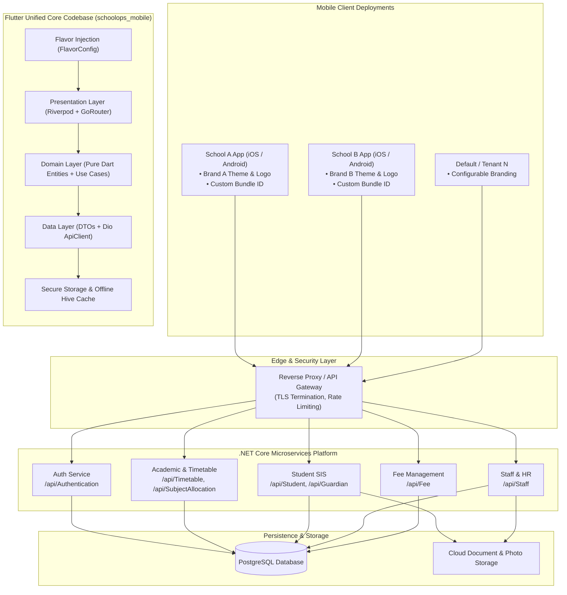
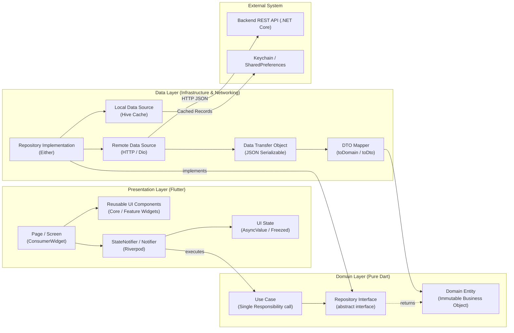
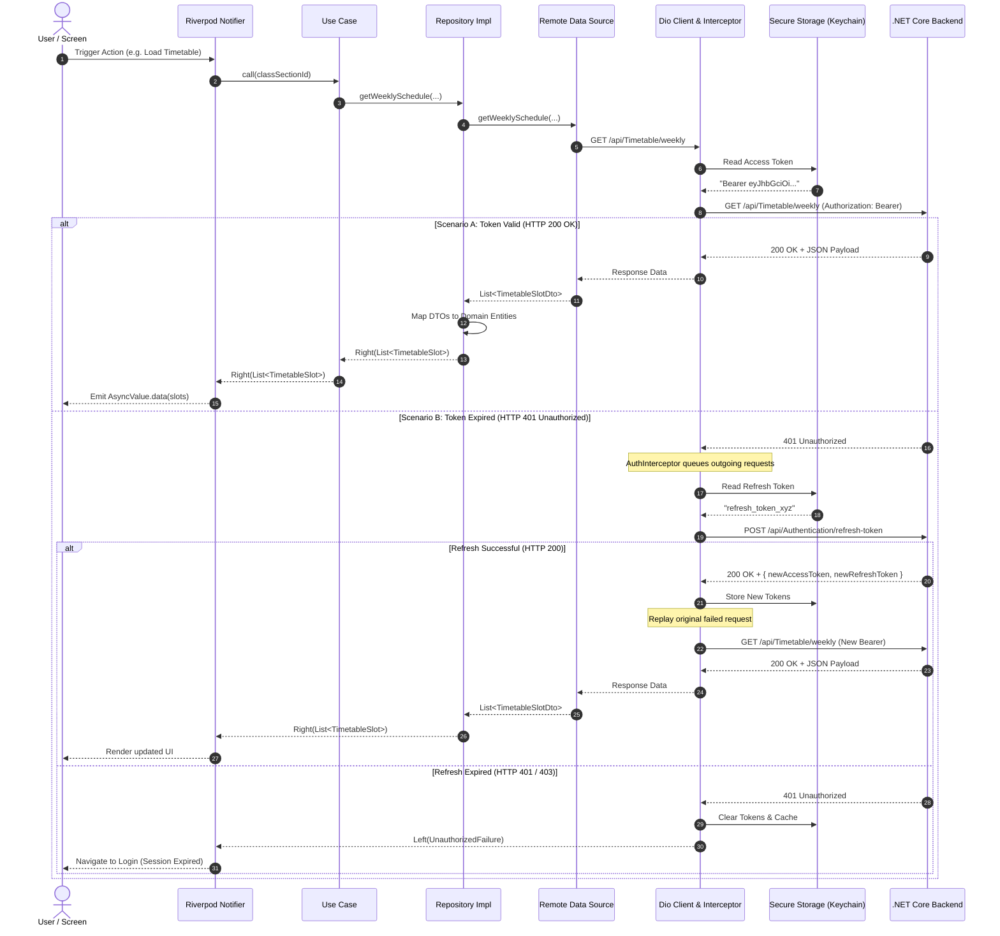
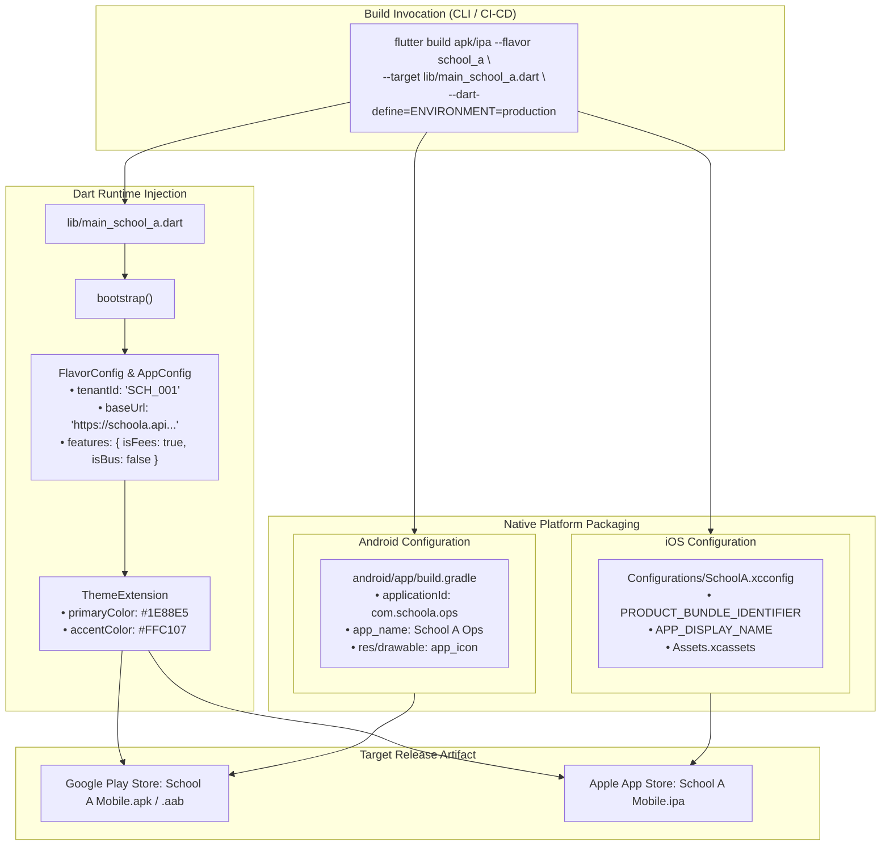
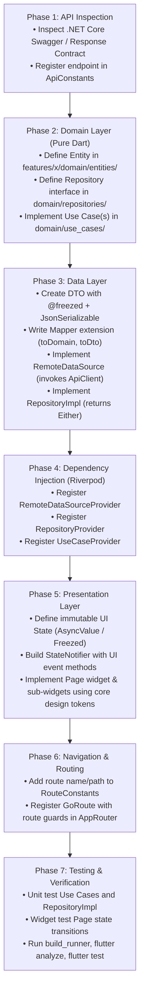

# SchoolOpsPro Mobile — Architecture & System Flow Blueprint

> **Enterprise Multi-Tenant Flutter Mobile Application for Android & iOS**  
> Powered by Clean Architecture, Riverpod 2.x, Dio, and .NET Core Microservices.

---

## 1. System Overview & Context Flow

SchoolOpsPro Mobile is designed as a single Flutter codebase that compiles to institution-specific branded releases (Android & iOS). Each application flavor communicates with .NET Core microservices backed by PostgreSQL.

### Diagram 1: High-Level System Architecture & Context Flow



---

## 2. Clean Architecture Layer & Dependency Flow

The application strictly obeys Robert C. Martin's Clean Architecture. Outer layers depend inward; the Domain layer contains zero references to Flutter UI or external transport mechanisms.

### Diagram 2: Layer Boundaries & Data Transformation Flow



---

## 3. End-to-End Request, Auth & Silent Token Refresh Flow

Authentication uses JWT access tokens and long-lived refresh tokens. Token injection and 401 recovery occur transparently within Dio interceptors without exposing credentials or logic to the presentation layer.

### Diagram 3: API Request & Silent 401 Token Refresh Sequence



---

## 4. Multi-School White-Label Build Architecture

SchoolOpsPro leverages Flutter Flavors combined with compile-time Dart Defines to compile custom-branded binaries from a single code repository.

### Diagram 4: White-Label Build Pipeline & Configuration Injection



---

## 5. Feature Development Lifecycle Flow

When developing a new feature (e.g., Timetable, Student Attendance, or Fees), follow the strict 7-phase Inside-Out pattern.

### Diagram 5: Inside-Out Feature Implementation Flow



---

## 6. Architecture Documentation Index

The complete architectural context is documented across dedicated Markdown files in `docs/architecture/`:

| Doc | Topic | Highlights |
|---|---|---|
| [GEMINI.md](file:///d:/MH_SchoolOps_Pro_Mobile/GEMINI.md) | AI Agent Master Entry Point | Critical instructions, mandatory read list, hard rules |
| [00-overview.md](file:///d:/MH_SchoolOps_Pro_Mobile/docs/architecture/00-overview.md) | System Overview | High-level system context, tech stack, constraints |
| [01-clean-architecture.md](file:///d:/MH_SchoolOps_Pro_Mobile/docs/architecture/01-clean-architecture.md) | Clean Architecture | 3-layer architecture, concentric dependency model |
| [02-project-structure.md](file:///d:/MH_SchoolOps_Pro_Mobile/docs/architecture/02-project-structure.md) | Project Structure | Complete directory tree and file placement rules |
| [03-dependency-rules.md](file:///d:/MH_SchoolOps_Pro_Mobile/docs/architecture/03-dependency-rules.md) | Dependency Rules | Strict layer import restrictions and boundaries |
| [04-core-module.md](file:///d:/MH_SchoolOps_Pro_Mobile/docs/architecture/04-core-module.md) | Core Module | Shared infrastructure, networking, design system |
| [05-feature-module.md](file:///d:/MH_SchoolOps_Pro_Mobile/docs/architecture/05-feature-module.md) | Feature Module | Feature blueprint and standard component directory |
| [06-api-architecture.md](file:///d:/MH_SchoolOps_Pro_Mobile/docs/architecture/06-api-architecture.md) | API & HTTP Client | Dio configuration, interceptor pipeline, error unwrapping |
| [07-authentication.md](file:///d:/MH_SchoolOps_Pro_Mobile/docs/architecture/07-authentication.md) | Authentication | JWT lifecycle, silent 401 refresh, secure token storage |
| [08-state-management.md](file:///d:/MH_SchoolOps_Pro_Mobile/docs/architecture/08-state-management.md) | State Management | Riverpod patterns, AsyncValue, reactivity rules |
| [09-dependency-injection.md](file:///d:/MH_SchoolOps_Pro_Mobile/docs/architecture/09-dependency-injection.md) | Dependency Injection | Riverpod as sole DI container; provider hierarchy |
| [10-navigation.md](file:///d:/MH_SchoolOps_Pro_Mobile/docs/architecture/10-navigation.md) | Navigation | GoRouter routing, route constants, and auth guards |
| [11-assets-and-icons.md](file:///d:/MH_SchoolOps_Pro_Mobile/docs/architecture/11-assets-and-icons.md) | Assets & Icons | Flavor asset overrides, resolution density, SVGs |
| [12-white-label.md](file:///d:/MH_SchoolOps_Pro_Mobile/docs/architecture/12-white-label.md) | White-Label Multi-School | Flavor build pipeline, runtime configs, dynamic theming |
| [13-environment-configuration.md](file:///d:/MH_SchoolOps_Pro_Mobile/docs/architecture/13-environment-configuration.md) | Environments | Development, Staging, Production configuration |
| [14-error-handling.md](file:///d:/MH_SchoolOps_Pro_Mobile/docs/architecture/14-error-handling.md) | Error Handling | Sealed Failure hierarchy, functional Either<L, R> flow |
| [15-validation.md](file:///d:/MH_SchoolOps_Pro_Mobile/docs/architecture/15-validation.md) | Validation | Client-side UX validation vs backend authority |
| [16-models-and-mapping.md](file:///d:/MH_SchoolOps_Pro_Mobile/docs/architecture/16-models-and-mapping.md) | Models & Mapping | DTO vs Domain Entity vs UI State separation |
| [17-storage.md](file:///d:/MH_SchoolOps_Pro_Mobile/docs/architecture/17-storage.md) | Storage | Secure Storage (tokens) + Hive (offline cache) |
| [18-security.md](file:///d:/MH_SchoolOps_Pro_Mobile/docs/architecture/18-security.md) | Security | Cryptography, logging hygiene, OWASP MASVS compliance |
| [19-testing.md](file:///d:/MH_SchoolOps_Pro_Mobile/docs/architecture/19-testing.md) | Testing | Unit test pyramid, mocks, widget tests, integration tests |
| [20-naming-conventions.md](file:///d:/MH_SchoolOps_Pro_Mobile/docs/architecture/20-naming-conventions.md) | Naming Conventions | File, class, method, provider, and variable naming laws |
| [21-coding-guidelines.md](file:///d:/MH_SchoolOps_Pro_Mobile/docs/architecture/21-coding-guidelines.md) | Coding Guidelines | Effective Dart, immutability, clean UI, hooks, linting |
| [22-ai-development-rules.md](file:///d:/MH_SchoolOps_Pro_Mobile/docs/architecture/22-ai-development-rules.md) | AI Agent Rules | Inviolable laws, forbidden patterns, pre-task checklist |
| [23-feature-development-process.md](file:///d:/MH_SchoolOps_Pro_Mobile/docs/architecture/23-feature-development-process.md) | Feature Process | Step-by-step feature development SOP |
| [24-decisions.md](file:///d:/MH_SchoolOps_Pro_Mobile/docs/architecture/24-decisions.md) | Architecture Decisions | Master ADR index and ADR template |

---

## 7. Developer Quickstart & Build Commands

### Code Generation
Whenever Freezed models or Riverpod providers are added or modified:
```bash
dart run build_runner build --delete-conflicting-outputs
```

### Static Analysis & Verification
```bash
flutter analyze
flutter test
```

### Running School Flavors (Development)
```bash
# Run School A in Development mode
flutter run --flavor school_a -t lib/main_school_a.dart --dart-define=ENVIRONMENT=development

# Run School B in Development mode
flutter run --flavor school_b -t lib/main_school_b.dart --dart-define=ENVIRONMENT=development
```

### Building Release Artifacts (Production)
```bash
# Build Android App Bundle (AAB) for School A
flutter build appbundle --flavor school_a -t lib/main_school_a.dart --dart-define=ENVIRONMENT=production

# Build iOS Archive (IPA) for School A
flutter build ipa --flavor school_a -t lib/main_school_a.dart --dart-define=ENVIRONMENT=production
```
